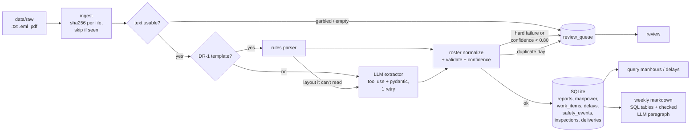

# field-report-pipeline

Turns superintendent daily reports into structured, queryable data and a weekly summary.


## The problem

Every day on a commercial job, the superintendent writes a daily report: weather, which subs
were on site with how many workers for how many hours, work completed, delays, safety events,
inspections, deliveries and visitors. It's the contemporaneous record of the job, and it's what
you reach for when an owner disputes a time extension or a sub disputes a back-charge.

The reports pile up as text, emails and PDFs, in whatever format and style each super prefers.
When the PM asks *"how many man-hours did the drywall sub put in this month?"* or *"how many
hours did we lose to RFIs?"*, someone reads them one by one.

This pipeline reads them once. It handles the company template with a deterministic parser,
uses an LLM for everything else, refuses to guess on anything it can't verify, and answers
those questions with SQL.

**On the 32 sample files (30 working days plus 2 deliberately broken reports):**
- 30 load automatically: 19 through the rules parser and 11 through the LLM.
- Both broken reports go to the review queue with a reason.
- Field-level F1 against 12 hand-checked gold reports is **0.995** (1.000 on the template, 0.992 on free-form).
- The LLM costs about **$0.010 per free-form report**. Template reports cost nothing.

Everything here is fictional: the project, the people, the companies and the agencies.

## Demo

All output below is real, produced by the commands shown in mock mode, which replays LLM
responses recorded earlier with `LLM_MODE=record` (see [Quick start](#quick-start)).

**Ingest a folder** (.txt templates, free-form .txt, .eml and .pdf):

```
$ fieldreports ingest data/raw
LLM: claude-sonnet-5-5, mode=mock
┌──────────────────────────────────┬────────┬────────┬──────┬─────────────────────────────────────────┐
│ file                             │ status │ method │ conf │ reason                                  │
├──────────────────────────────────┼────────┼────────┼──────┼─────────────────────────────────────────┤
│ DR_2026-08-31_HarborPoint.txt    │ loaded │ rules  │ 1.00 │                                         │
│ DR_2026-09-01_HarborPoint.txt    │ loaded │ rules  │ 1.00 │                                         │
│ DR_2026-09-02_HarborPoint.txt    │ loaded │ rules  │ 1.00 │                                         │
│ DR_2026-09-03_HarborPoint.txt    │ loaded │ rules  │ 1.00 │                                         │
│ DR_2026-09-08_HarborPoint.pdf    │ loaded │ rules  │ 1.00 │                                         │
│ DR_2026-09-09_HarborPoint.txt    │ loaded │ rules  │ 1.00 │                                         │
│ DR_2026-09-10_HarborPoint.txt    │ loaded │ rules  │ 1.00 │                                         │
│ DR_2026-09-14_HarborPoint.txt    │ loaded │ rules  │ 1.00 │                                         │
│ DR_2026-09-15_HarborPoint.txt    │ loaded │ rules  │ 1.00 │                                         │
│ DR_2026-09-16_HarborPoint.txt    │ loaded │ rules  │ 1.00 │                                         │
│ DR_2026-09-17_HarborPoint.txt    │ loaded │ rules  │ 1.00 │                                         │
│ DR_2026-09-21_HarborPoint.txt    │ loaded │ rules  │ 1.00 │                                         │
│ DR_2026-09-22_HarborPoint.txt    │ loaded │ rules  │ 1.00 │                                         │
│ DR_2026-09-23_HarborPoint.pdf    │ loaded │ rules  │ 1.00 │                                         │
│ DR_2026-09-24_HarborPoint.txt    │ loaded │ rules  │ 1.00 │                                         │
│ DR_2026-10-05_HarborPoint.txt    │ loaded │ rules  │ 1.00 │                                         │
│ DR_2026-10-06_HarborPoint.txt    │ loaded │ rules  │ 1.00 │                                         │
│ DR_2026-10-07_HarborPoint.txt    │ loaded │ rules  │ 1.00 │                                         │
│ DR_2026-10-08_HarborPoint.txt    │ loaded │ rules  │ 1.00 │                                         │
│ DR_HarborPoint_draft.txt         │ review │ rules  │ 1.00 │ missing required field: report_date     │
│ Daily - Harbor Pt MOB - 10-9.eml │ loaded │ llm    │ 1.00 │                                         │
│ Daily - Harbor Pt MOB - 9-18.eml │ loaded │ llm    │ 1.00 │                                         │
│ Daily - Harbor Pt MOB - 9-28.eml │ loaded │ llm    │ 1.00 │                                         │
│ Daily - Harbor Pt MOB - 9-30.eml │ loaded │ llm    │ 1.00 │                                         │
│ Daily - Harbor Pt MOB - 9-4.eml  │ loaded │ llm    │ 1.00 │                                         │
│ SCAN0047.txt                     │ review │        │      │ text looks garbled (12% of tokens are   │
│                                  │        │        │      │ words; OCR noise?)                      │
│ daily 10-2.txt                   │ loaded │ llm    │ 1.00 │                                         │
│ daily 9-11.txt                   │ loaded │ llm    │ 1.00 │                                         │
│ daily 9-25.txt                   │ loaded │ llm    │ 1.00 │                                         │
│ daily 9-26.txt                   │ loaded │ llm    │ 1.00 │                                         │
│ daily 9-29.txt                   │ loaded │ llm    │ 1.00 │                                         │
│ daily notes 10-1.pdf             │ loaded │ llm    │ 1.00 │                                         │
└──────────────────────────────────┴────────┴────────┴──────┴─────────────────────────────────────────┘
loaded 30 | review 2 | pending 0 | already ingested 0
LLM calls 11: 4,725 input + 9,114 output tokens, $0.1136 (replayed from fixtures, nothing billed)
```

The draft reads 1.00 because the parser read it perfectly. The report itself has no date, which is a hard
failure regardless of confidence.

**Run it again and nothing changes.** Files are fingerprinted by the sha256 of their bytes:

```
$ fieldreports ingest data/raw
LLM: claude-sonnet-5-5, mode=mock
loaded 0 | review 0 | pending 0 | already ingested 32
```

**"How many man-hours did each sub put in, the week of the rain?"**

```
$ fieldreports query manhours --by sub --week 2026-09-21
                            Man-hours by sub, week of 2026-09-21
┌─────────────────────────────────┬────────────────┬──────────────┬─────────────┬───────────┐
│ company                         │ trade          │ days_on_site │ worker_days │ man_hours │
├─────────────────────────────────┼────────────────┼──────────────┼─────────────┼───────────┤
│ Keystone Interiors LLC          │ drywall        │ 5            │ 49          │ 392.0     │
│ Volt Line Electric, Inc.        │ electrical     │ 5            │ 39          │ 312.0     │
│ Summit Roofing & Sheet Metal    │ roofing        │ 5            │ 31          │ 224.0     │
│ Tidewater Mechanical            │ hvac           │ 5            │ 28          │ 224.0     │
│ Glassline Curtainwall           │ curtain_wall   │ 5            │ 25          │ 170.0     │
│ Redline Fire Protection         │ fire_sprinkler │ 5            │ 19          │ 152.0     │
│ Bayline Builders (self-perform) │ laborers       │ 6            │ 17          │ 136.0     │
│ Clearwater Plumbing Co.         │ plumbing       │ 5            │ 15          │ 120.0     │
└─────────────────────────────────┴────────────────┴──────────────┴─────────────┴───────────┘
```

Roofing and curtain wall show 5 days in a 6-day week: they were rained out on Tuesday 9/22
and came back for the Saturday make-up day. The free-form super wrote "keystone 9 guys",
"framers x13 (10 hrs)" and "electricians x8"; the roster resolves all of those to the same
companies the template uses.

Project to date, `fieldreports query manhours --by sub` gives 10,290 man-hours across 9
companies. That matches the generator's ground truth to the hour, company by company.

**"How many hours did we lose, and to what?"**

```
$ fieldreports query delays --by cause
       Delay hours by cause, all dates
┌──────────────┬────────┬───────┬────────────┐
│ cause        │ events │ hours │ rfis       │
├──────────────┼────────┼───────┼────────────┤
│ weather      │ 2      │ 12.0  │            │
│ material     │ 3      │ 7.0   │            │
│ rfi          │ 3      │ 6.5   │ 11, 14, 17 │
│ equipment    │ 2      │ 3.0   │            │
│ inspection   │ 1      │ 3.0   │            │
│ labor        │ 1      │ 2.5   │            │
│ owner_change │ 1      │ 2.0   │            │
└──────────────┴────────┴───────┴────────────┘
```

All 13 delay events match the source reports, including "lost 2 hrs - waiting on RFI 14
response" from a free-form note.

**What needs a human:**

```
$ fieldreports review
                                           Needs review (2)
┌──────────────────────────┬──────────────────────────────────────────────┬───────────────────────────┐
│ file                     │ reason                                       │ queued (UTC)              │
├──────────────────────────┼──────────────────────────────────────────────┼───────────────────────────┤
│ DR_HarborPoint_draft.txt │ missing required field: report_date          │ 2026-10-14T17:29:20+00:00 │
│ SCAN0047.txt             │ text looks garbled (12% of tokens are words; │ 2026-10-14T17:29:21+00:00 │
│                          │ OCR noise?)                                  │                           │
└──────────────────────────┴──────────────────────────────────────────────┴───────────────────────────┘
```

**Weekly summary:** `fieldreports weekly --week 2026-09-21` writes
[docs/sample_weekly_2026-09-21.md](docs/sample_weekly_2026-09-21.md). It contains:
- man-hours by company
- a daily log with weather and who extracted each report
- delays by cause and by event, with RFI numbers
- safety, inspections, deliveries and visitors
- a flag for any weekday with no report on file

Every table and number comes from SQL. An LLM writes only the one-paragraph summary, and that
paragraph is rejected if it contains any number that isn't in the SQL results. The sample on disk
uses the template paragraph, and says so: the narrative call hasn't been recorded yet.

## Architecture



## Eval

`fieldreports eval` scores extraction against 12 hand-checked gold reports covering every
format: 3 template .txt, 2 template .pdf, 3 free-form .txt, 3 .eml and 1 free-form .pdf.
Scoring is field-level: each crew's company, trade, headcount and hours is one fact, and so on
for every section. List items are matched regardless of order. Numbers, enums and names must
match exactly; free-text fields match at token Dice ≥ 0.6. The full method is in
[evaluate.py](src/fieldreports/evaluate.py), and the complete output, every error included, is
in [eval/results.md](eval/results.md).

| Method | Reports | Precision | Recall | F1 |
|---|---|---|---|---|
| Rules | template (5) | 1.000 | 1.000 | 1.000 |
| Rules | free-form (7) | 0.000 | 0.000 | 0.000 |
| Pipeline (rules first, LLM fallback) | template (5) | 1.000 | 1.000 | 1.000 |
| Pipeline (rules first, LLM fallback) | free-form (7) | 0.991 | 0.993 | 0.992 |
| Pipeline (rules first, LLM fallback) | all (12) | 0.994 | 0.996 | 0.995 |

The pipeline sends free-form reports to the LLM, so the free-form row is the LLM's score.
By section (all 12): header, weather, manpower (396 facts), delays, inspections, visitors and
notes are all 1.000.
- **work_completed: 0.993.** One ambiguous area: "cleaned l1 and l2 … L1 east".
- **deliveries: 0.909.** Quantities like "8 bunks" went to `notes` instead of staying in
  `material`.
- **safety_events: 0.800, the one that matters.** The LLM dropped "safety obs: ladder missing a
  foot found on l2; tagged out and removed" from the 9/25 report entirely. The weekly summary
  for that week therefore says "No safety events reported", which is wrong. Confidence scoring
  didn't catch it, because a fact that's missing has no number to check against the source. This is
  the next prompt iteration (see [Roadmap](#roadmap)).

In mock mode the eval is deterministic and runs in CI. `--record` fills in any missing
recordings, and `--live` calls the API without saving anything. The rules-vs-LLM comparison
on identical template inputs (the LLM also run on the 5 template reports) needs one more
`fieldreports eval --record`.

## Quick start

```bash
git clone https://github.com/Deepikapriya9779/field-report-pipeline.git
cd field-report-pipeline
python -m venv .venv && source .venv/bin/activate   # Windows: .venv\Scripts\activate
pip install -e ".[dev]" -c constraints.txt
```

```bash
fieldreports ingest data/raw          # mock mode by default: replays recorded LLM responses
fieldreports query manhours --by sub --week 2026-09-21
fieldreports query delays --by cause
fieldreports review
fieldreports weekly --week 2026-09-21 --no-llm
fieldreports eval --methods rules,pipeline
pytest                                # 187 tests, no network (sockets are blocked)
```

To use the API, copy `.env.example` to `.env` and set `ANTHROPIC_API_KEY`. The `LLM_MODE`
setting has three values:
- `mock` (default without a key): replays fixtures from `tests/fixtures/llm/`. A missing or
  stale fixture stops the run with a re-record message. It never makes up a response.
- `record`: calls the API for any request without a fixture and saves the response, with the
  model, a timestamp and token usage. `LLM_RECORD_REFRESH=1` re-records everything.
- `live`: calls the API and saves nothing.

The model comes from `ANTHROPIC_MODEL` (default `claude-sonnet-5-5`). `--rules-only` on
`ingest` skips the LLM entirely.

To regenerate the sample data: `python scripts/generate_reports.py`. It's seeded, so it
produces identical bytes every time.

## Design decisions

**Rules first, LLM second.** Most of a GC's reports come in on the company form. A
regex parser reads it for free, in milliseconds, with exact output (F1 1.000 on the template
gold, PDFs included). The LLM only sees what the rules can't read: free-form notes, emails,
or a template filled in wrong (the parser raises instead of guessing, and the report falls
through). The route depends on the content, not the file type: a PDF printed from the form goes
to the rules parser.

**A review queue instead of guessing.** A wrong number in a delay log is worse than a missing
one, because it ends up in a claim or a pay application. Anything the pipeline can't vouch for
goes to `review_queue` with a reason, and never touches the fact tables:
- missing project, date or superintendent
- a date in the future
- a headcount over 500
- more than 24 hours per worker or per delay
- another job's report
- garbled text
- a second report for a day that's already loaded
- a confidence score below 0.80

The extractor is allowed to say "not stated": the header fields are nullable, so a blank date
becomes a review item rather than an invented date.

**Confidence is a heuristic, and it's labeled as one.** It starts at 1.0 and loses points for:
- every number the extractor produced that doesn't appear in the source text (the strongest
  sign of a hallucination)
- needing a retry
- a company not on the roster
- a report with no crews

It isn't a calibrated probability. It can't catch a fact that's missing (see the eval).

**Tool use with schema validation.**
- **The schema.** The tool's `input_schema` is generated from the pydantic model, with the JSON Schema keywords
strict mode doesn't support (like `minimum`) stripped out and enforced by pydantic on the client side instead.
- **Tool choice.** `tool_choice` is `auto`, because Claude Sonnet 5.5 rejects forced tool choice. A
  response without a tool call counts as a failed attempt.
- **Retry.** Invalid input gets exactly one retry, with the validation error sent back as an
  `is_error` tool result.
- **Refusal or cut-off.** A refusal or a truncated response goes to review and is never parsed.

**Domain choices:**
- **Man-hours are `headcount × hours`, computed in SQL.** `hours` is hours per worker
  (the shift length), which is what the "> 24 hours" check needs. A derived column can't drift
  out of sync with its inputs.
- **Delay hours are clock hours as the super reported them, not crew-hours.** Reports rarely
  say which crew stood idle, and multiplying by headcount would invent numbers. Overlapping delays
  aren't de-duplicated, and the weekly page says so.
- **The report date is never inferred** from a file's timestamp or an email's `Date:`
  header. One sample email was sent at 00:42 the next morning.
- **A project roster** (`data/project.yaml`) turns "elec 6 guys" into *Volt Line Electric,
  Inc. / electrical*. Man-hours by sub only work if every nickname resolves to one company.

**Recorded fixtures, keyed by the whole request.**
- **The key.** It's the sha256 of the model, system prompt, tool schema and messages, so any
  change to any of them requires a re-record instead of silently replaying a stale answer.
- **Pinned versions.** The request includes the pydantic-generated schema and the pdfplumber
  text, so those versions are pinned in `constraints.txt`.
- **No network in tests.** Tests refuse all socket connections.

**Cost per report.** The recorded run was 11 calls on `claude-sonnet-5-5` at effort `low`:
- 4,725 uncached input tokens, 28,960 cache-read tokens, 2,896 cache-write tokens and 9,114
  output tokens: **$0.1136, or $0.0103 per free-form report**.
- The 2,896-token system prompt and tool schema are cached after the first call.
- Template reports cost $0, so the 30 loaded reports average under $0.004 each.
- At that rate, a super filing free-form reports every working day costs about $2.60 a year.

## Limitations

- **The data is synthetic.** It has two writers and a limited set of phrasings from a seeded
  generator. Real superintendents write messier reports, so treat the F1 as an upper bound,
  not a forecast. The next real test is a few hundred real reports with gold labels.
- **Missing facts are invisible to confidence.** The missed safety observation loaded at 1.00.
  A second check (for example, a cheap "list every safety-related line" pass) would catch this
  class of miss.
- **No OCR.** A scanned PDF without a text layer is rejected as "no extractable text". A
  garbled OCR result is rejected too.
- **One sub per trade** is assumed when resolving a bare trade word ("elec"). With two
  electricians on a job, it stays unresolved and the report loses confidence.
- **The week is the only time filter.** A month or custom date range is a small SQL change,
  not built yet.
- **Revised reports** go to review. Picking the right version is a human call.
- **Not yet recorded:** the LLM on the 5 template gold reports (the rules-vs-LLM comparison)
  and the weekly narrative paragraph. Both are one `--record` run away.
- **CI** is configured for Python 3.11 and 3.12 but has only been run locally (Windows,
  Python 3.13).

## Roadmap

- **Inputs from where reports already live.** A Procore Daily Log connector (manpower,
  weather, notes and delays are already structured there), plus an email-inbox watcher for
  supers who email their dailies.
- **Photo attachments.** Supers attach progress and safety photos. Vision extraction could tag
  them to work items and safety events.
- **Safety recall.** Fix the missed observation with a prompt change, re-record, and report the
  before/after in the eval.
- **Review UI.** Approve, edit or reject review items, so the fixes become new gold data.
- **Date ranges and exports.** Month-to-date man-hours by sub, and a CSV/Excel export for pay
  application backup.

## Repo layout

```
src/fieldreports/
  schema.py     pydantic models (ReportFields = what extractors fill; DailyReport adds provenance)
  roster.py     canonical project, super, sub and trade names
  loaders.py    .txt/.eml/.pdf -> text, sha256
  rules.py      DR-1 template parser
  extract.py    routing: rules first, LLM fallback
  llm.py        Anthropic tool use, retry, record/live/mock fixtures, weekly narrator
  validate.py   hard checks, confidence, garbled-text detection
  pipeline.py   one document -> loaded | review | pending
  db.py         SQLite schema and writes
  ingest.py     folder ingest, idempotency, duplicate days
  queries.py    every SQL query
  weekly.py     weekly markdown
  evaluate.py   field-level P/R/F1
  cli.py        typer + rich
scripts/generate_reports.py   seeded synthetic data
data/raw  data/gold  data/project.yaml
tests/        187 tests; tests/fixtures/llm holds the recorded responses
```

See [LEARNING.md](LEARNING.md) for a code walkthrough, the construction background, every
design decision with its alternatives, and interview prep.

MIT license.
